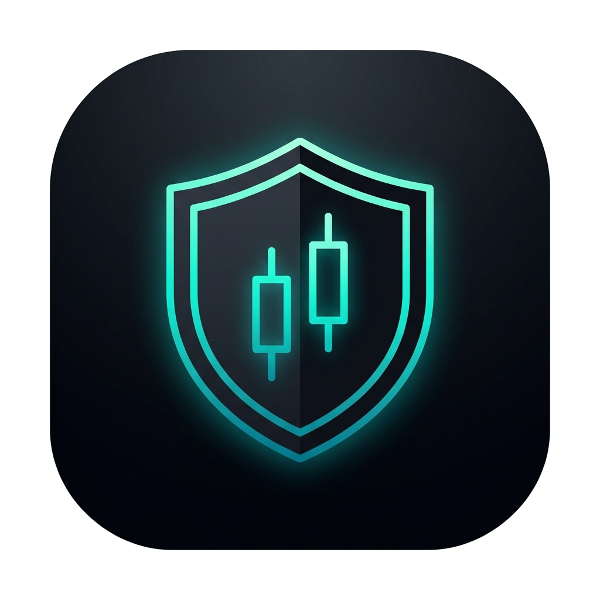
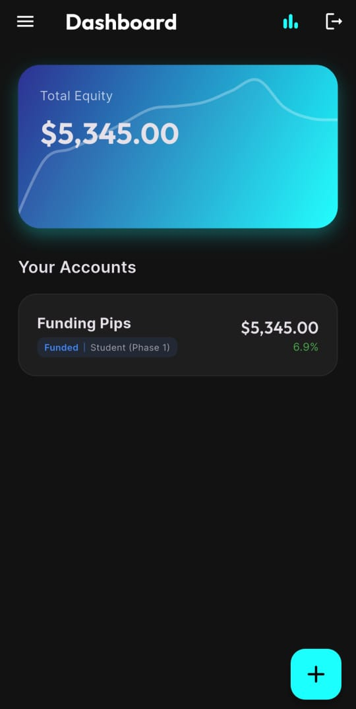
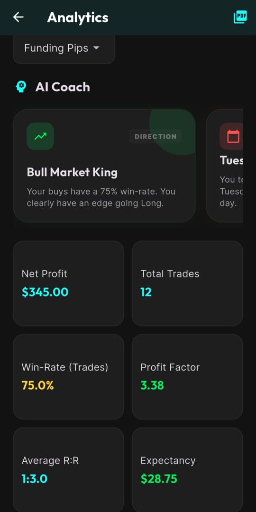
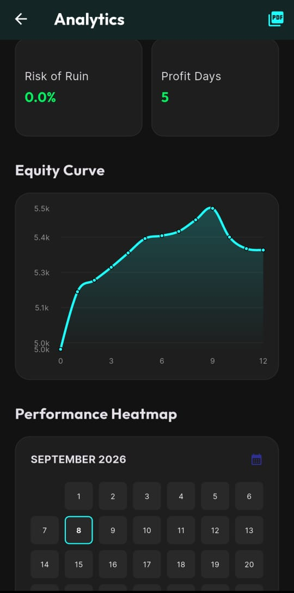
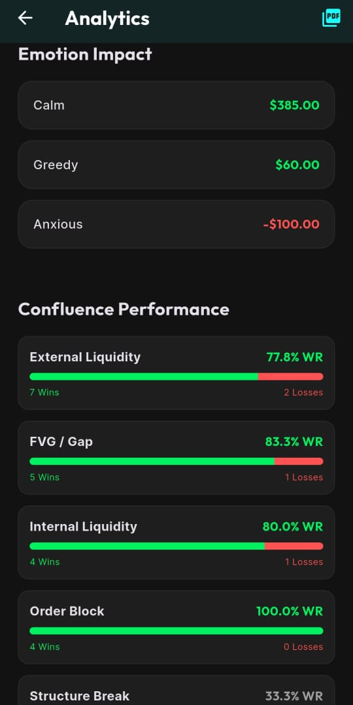
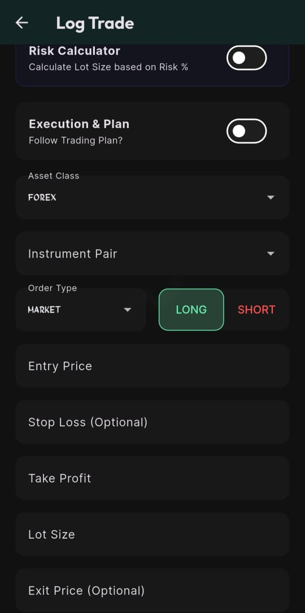

<p align="center">
  
</p>

<h1 align="center">ZenTrader</h1>

<p align="center">
  Diario de trading, calculadora de lote, cuentas y desafíos de prop firm, analítica con AI Coach,<br/>
  cuentas verificadas con perfil público y ZenScore. Offline-first, con sincronización en la nube y membresías por niveles.
</p>

<p align="center">
  <a href="https://zentrader.webtrader.trade">🔗 Sitio del proyecto</a> ·
  <a href="https://zentrader.webtrader.trade/app/">📱 Probar la app en la web</a> ·
  <a href="https://zentrader-app.webtrader.trade">👥 Página para usuarios</a>
</p>

> 🔒 **El código fuente de este proyecto es privado.** Este repositorio es una vista general (arquitectura, funciones, capturas) para portafolio. El código está disponible bajo solicitud en una entrevista.

---

## Capturas reales

<p align="center">
  
  
  
  
  
</p>

## Qué hace

- **Diario de trading**: registro completo (par, entrada, SL/TP, lote, riesgo %, confluencias, emoción) o "Quick Log" en segundos.
- **Calculadora de lote**: lote exacto según capital, % de riesgo y distancia al Stop Loss, con especificaciones de contrato por instrumento. En Android, **burbuja flotante** encima de MT4/MT5 o TradingView y **widget de pantalla de inicio**.
- **Cuentas y desafíos**: varias cuentas (real, demo, prop firm) con reglas de drawdown, objetivo y días mínimos en tiempo real.
- **Analítica y AI Coach**: net profit, win rate, profit factor, expectativa, riesgo de ruina, curva de equity, heatmap por día, rendimiento por par/emoción/confluencia/hora, e insights automáticos.
- **ZenScore (0-100)**: nota por cuenta que combina rentabilidad y disciplina (riesgo y stop loss, lotaje consistente, cumplimiento del plan de trading, drawdown). Una sola implementación compartida por la app y el perfil público, cubierta con tests.
- **Cuentas verificadas**: se comparte el reporte HTML del broker (MT4/MT5) directo a la app desde Drive, WhatsApp o Archivos, o se vincula la cuenta vía MetaApi. Las cuentas verificadas llevan insignia.
- **Perfil público**: rendimiento total con curva de capital animada, KPIs, ZenScore y operaciones recientes, sin mostrar montos. Se publica en una web aparte de perfiles.
- **Mis estrategias**: estrategias con checklist de entrada (todos los planes) y estadísticas por estrategia en todas las cuentas (desde Pro); al registrar un trade se marca el checklist y se califica la ejecución.
- **Plan de trading**: reglas contra la sobreoperación (operaciones por día, % de riesgo, pérdida diaria máxima, parar tras pérdidas seguidas) en todas las cuentas. Avisa sin bloquear al registrar un trade que lo rompe, el coach mide el cumplimiento y el ZenScore lo penaliza. Recomendado para todos, personalizable en Elite.
- **Logros y notas**: gamificación de hábitos y notas relacionadas con operaciones de cualquier cuenta (real, fondeada, demo o backtest), con su resumen.
- **Recordatorios de práctica**: notificaciones locales programadas en el teléfono a los 2, 7 y 14 días sin registrar en backtest, demo o real (fondeada: 25, por la regla de inactividad de las firmas). Los días se basan en estudios de hábitos y de pérdida de habilidades; se reprograman al abrir la app o registrar un trade. Consejo de trading diario en todos los planes; los avisos, desde Pro.
- **Seguridad**: login con huella, almacenamiento cifrado y borrado de cuenta desde la app.
- **Membresías**: Free / Pro / Elite / Unlimited (mensuales). Google Play Billing en la versión de Play Store; en web y APK directa, USDT (Binance Pay / TRC20) aprobado por un administrador.
- **Panel de administración**: usuarios y membresías con vencimiento, pagos pendientes, planes, control de versión (actualización opcional u obligatoria) y analítica de uso de la app.
- **Exportación e idiomas**: CSV y PDF; español e inglés.
- **Diseño**: kit visual propio para el menú y todas las pantallas, con varios temas (incluido uno claro) y animaciones.

## Arquitectura

```
┌───────────────────┐       HTTPS/JSON       ┌───────────────────┐
│    App Flutter    │ ─────────────────────▶ │ API Node/Express  │
│  Android/iOS/Web  │ ◀───────────────────── │    + JWT, PM2     │
│  SQLite (offline) │                        └─────────┬─────────┘
└─────────┬─────────┘                                  │
          │ canales nativos (Kotlin):                  ▼
          │ reporte compartido, burbuja,     ┌───────────────────┐
          ▼ widget de inicio                 │    PostgreSQL     │
     Android                                 └───────────────────┘
```

- **App**: Flutter (Android/iOS/Web), offline-first con SQLite (también en web), `provider` para el estado. Sin conexión, el login pasa solo a modo local y conserva la membresía de la última sesión online.
- **Builds**: el mismo código genera la app móvil, la web de perfiles públicos, la web con la app completa y el build de Play Store, elegidos con banderas de compilación.
- **Backend**: Node.js + Express, JWT + bcrypt, rate limiting, subida de archivos con Multer, correo con Nodemailer, datos de mercado con Yahoo Finance.
- **Base de datos**: PostgreSQL (migraciones en SQL plano).
- **Hosting**: API y webs en servidor propio (DigitalOcean + nginx) detrás de Cloudflare.

## Stack técnico

`Flutter` · `Dart` · `Provider` · `SQLite` · `fl_chart` · `awesome_notifications` · `Kotlin` · `Google Play Billing` · `Node.js` · `Express` · `PostgreSQL` · `JWT` · `Nodemailer` · `nginx` · `Cloudflare`

---

<p align="center">Desarrollado por <a href="https://www.linkedin.com/in/airan-bracamonte">Airan Bracamonte</a></p>
